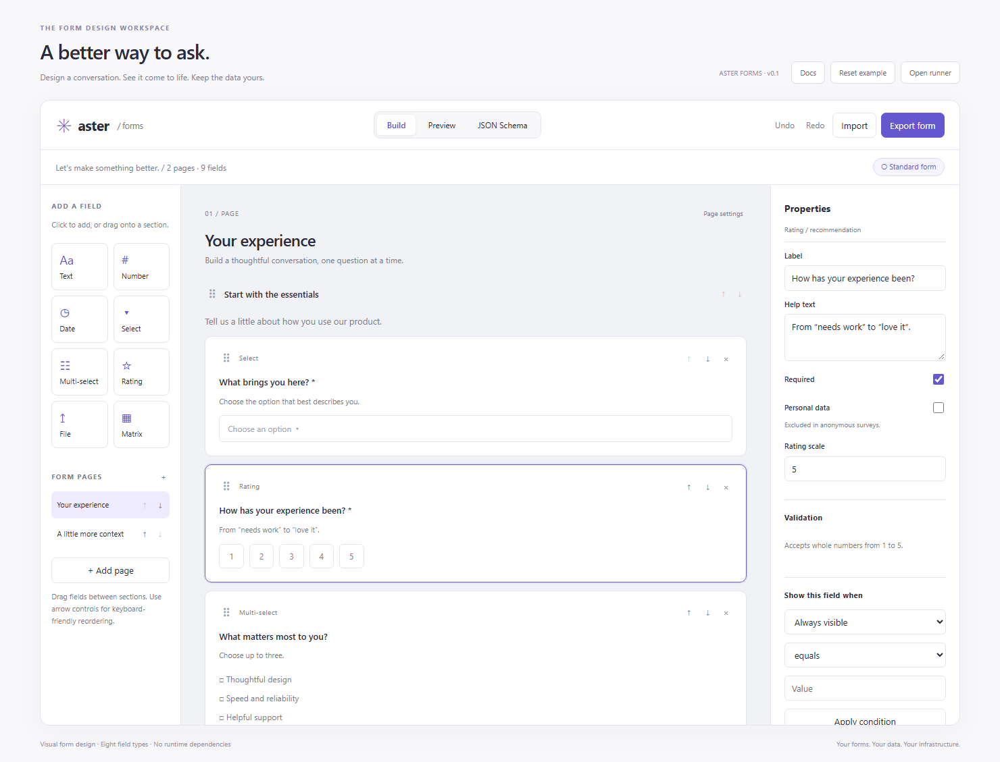

# Aster Forms

A **visual form builder and survey runner** with TypeScript definitions, JSON Schema export, and zero runtime dependencies.



Design multi-page forms, configure validation and conditional questions, and collect responses through an embeddable runner. Keep form definitions, validation rules, and response handling under your application's control.

## Features

- **Eight field types:** text, number, date, select, multi-select, rating, file, and a single-choice-per-row matrix.
- **Visual builder:** drag fields within/between sections, add/reorder pages and sections, and arrow buttons for keyboard-friendly reordering. Sections can move to other pages through the page outline. Every page retains at least one section.
- **Properties panel:** label, help text, required/personal-data flags, type-specific validation, options, rating scale, file limits and matrix rows/columns.
- **Conditional visibility:** equality, inequality and multi-select containment. The API supports nested AND/OR rules. Cycles and unknown references are rejected.
- **JSON Schema 2020-12:** answer schema and complete submission-envelope schema, including conditional requirements and rejection of hidden answers.
- **Runner:** all field inputs, live visibility, page navigation, error summaries, file selection and multipart assembly, asynchronous submit/retry and success state.
- **Anonymous surveys:** no automatic identity/tracking/storage; personal-data fields, uploads and their dependent fields are excluded.
- **Import/export, preview, undo/redo** and a framework-independent headless model.

## Run the demo

```sh
git clone https://github.com/ishangupta-1510/aster-forms.git
cd aster-forms
npm install
npm run demo
```

Open **http://127.0.0.1:4174**. The demo includes all field types, conditional fields, two pages, and a runner that displays the submitted JSON locally. It does not send responses, persist them, or upload files to a server. Native browser controls may format displayed dates according to the browser locale; JSON answers always use `YYYY-MM-DD`.

## Use the library

No npm registry release is assumed. Create a local package with `npm pack`, then install the resulting `.tgz` into your project.

```js
import { FormBuilder, FormRunner, createForm, createField } from "aster-forms";
import "aster-forms/style.css";

const form = createForm("Product feedback");
form.id = "feedback";
const field = createField("rating", "satisfaction");
field.label = "How was your experience?";
field.required = true;
form.pages[0].sections[0].fields.push(field);

const builder = new FormBuilder(document.querySelector("#builder"), {
  form,
  onChange(definition) {
    // Explicitly save the definition through your application's API if desired.
  },
});

const runner = new FormRunner(document.querySelector("#runner"), form, {
  async onSubmit(submission, { files }) {
    // `files` maps field IDs to actual File objects.
    // For a form without uploads:
    const response = await fetch("/api/responses", {
      method: "POST",
      headers: { "Content-Type": "application/json" },
      body: JSON.stringify(submission),
    });
    if (!response.ok)
      throw new Error("The response could not be saved. Retry.");
  },
});

// When the host component unmounts:
// builder.destroy();
// runner.destroy();
```

Without a bundler, serve `src/`, load `src/style.css`, and import `src/index.js` from a module script. See the working demo. React, Vue and Angular can mount these classes in a container and destroy them on unmount; dedicated framework wrappers are not included.

## Definition and answer formats

A **form definition** describes layout and presentation. A **JSON Schema** validates the answers, not the visual layout. Keep both on your server.

```js
const form = {
  id: "signup",
  version: 1,
  title: "Tell us about yourself",
  description: "",
  settings: { anonymous: false },
  pages: [
    {
      id: "page_1",
      title: "About you",
      sections: [
        {
          id: "section_1",
          title: "Basics",
          fields: [
            {
              ...createField("select", "role"),
              required: true,
              options: [
                { value: "customer", label: "Customer" },
                { value: "partner", label: "Partner" },
              ],
            },
            {
              ...createField("text", "company"),
              label: "Organization",
              required: true,
              personalData: true,
              visibleWhen: { field: "role", op: "eq", value: "partner" },
              validation: { maxLength: 120 },
            },
          ],
        },
      ],
    },
  ],
};
```

IDs are stable lowercase identifiers (`a-z`, digits, underscores), maximum 64 characters, starting with a letter. Page, section and field IDs are globally unique within a definition. Reserved prototype property names are rejected. Use `createField(type, id)` to supply defaults for a type, then customize them. `assertForm()` rejects invalid definitions before they enter the builder or runner. Limit: 50 pages, 100 sections per page, 500 total fields and 100 options per choice list.

| Type           | Stored answer                              | Validation                                              |
| -------------- | ------------------------------------------ | ------------------------------------------------------- |
| `text`         | String                                     | Unicode code-point length, regular expression           |
| `number`       | Number                                     | Minimum, maximum, optional whole-number constraint      |
| `date`         | `YYYY-MM-DD` string                        | Real calendar date                                      |
| `select`       | Option value string                        | Configured choices only                                 |
| `multi-select` | Unique array of option value strings       | Choice membership, min/max selections                   |
| `rating`       | Integer                                    | 1 to a configured scale of 2–10                         |
| `file`         | Array of `{name, size, type}` descriptors  | File count, bytes per file, exact MIME types            |
| `matrix`       | Object mapping row values to column values | Configured keys/values; required matrices need all rows |

Blank inputs are omitted by the runner. Explicit empty strings/arrays/objects are invalid answer values in the schema. Numeric zero remains a valid answer where permitted. Text is not trimmed; whitespace counts toward length. Optional matrices may be partially answered; required ones must be complete. Each matrix row accepts one radio choice. Date range rules, dynamic matrix rows, rich text and calculated values are outside this release.

## Conditional logic

```js
field.visibleWhen = {
  all: [
    { field: "role", op: "eq", value: "partner" },
    {
      any: [
        { field: "team_size", op: "ne", value: 1 },
        { field: "interests", op: "includes", value: "support" },
      ],
    },
  ],
};
```

The properties panel edits one condition at a time; the JSON definition/API supports compound rules. Option comparisons use stored values, not display labels. Numeric comparisons require numeric condition values. A missing or hidden controller makes its comparison false, including `ne`. A field's visibility also depends on its controller's visibility, so stale hidden answers cannot reveal another field. File and matrix fields cannot act as condition controllers in this version.

When an answer hides a field, the runner clears that field's value and selected files immediately. Revealing it again shows a blank input. Deleting a field/page/section in the builder clears external visibility rules referencing removed fields; undo restores both the removed items and their rules. There is no arbitrary expression execution or `eval` in Aster's engine.

## Server validation with standard JSON Schema

```js
import Ajv2020 from "ajv/dist/2020.js";
import addFormats from "ajv-formats";
import { toJSONSchema, submissionSchema } from "aster-forms";

const ajv = new Ajv2020({
  allErrors: true,
  strict: true,
  strictRequired: false,
});
addFormats(ajv); // Required to enforce the standard date format.
const validate = ajv.compile(submissionSchema(trustedFormDefinition));

// In a request handler:
if (!validate(requestBody)) {
  // Return 422 and validation errors; do not save this response.
}
```

Use `toJSONSchema(form)` to validate an answer object alone, or `submissionSchema(form)` for the complete envelope. The schema locks form ID, version and mode and rejects unknown envelope properties. `strictRequired: false` permits requirements inside conditional branches that reference properties defined at the root. `additionalProperties: false` rejects unknown answers. Hidden fields are forbidden, and visible required fields are enforced with standard `if`/`then`/`else` clauses. An independent Ajv test suite checks equivalence with the built-in validator.

Run `node examples/validate-on-server.js` for a complete working example. Ajv is a development/example dependency, not an Aster runtime dependency. Use a 2020-12 validator with format assertions enabled on your server. Never accept a respondent-supplied schema or anonymous-mode flag as authoritative: look up the trusted definition and settings by form/version.

## File uploads

The runner holds browser `File` objects in memory. `getFiles()` returns those objects keyed by field ID, while answers contain only their JSON-compatible descriptors. Native file controls and declared metadata provide client-side checks. `createFormData()` assembles a validated `submission` JSON part and repeated `file:<fieldId>` parts:

```js
const runner = new FormRunner(container, form, {
  async onSubmit() {
    const response = await fetch("/api/responses-with-files", {
      method: "POST",
      body: runner.createFormData(),
    });
    if (!response.ok) throw new Error("Upload failed. Please retry.");
  },
});
```

The library does not provide an upload service, file storage, or an antivirus scanner. Your server must enforce body limits, compare uploaded bytes/counts against descriptors, inspect actual file type, and store files safely. A JSON Schema can validate file metadata, not prove that the matching bytes were received or are safe. File selection is intentionally not persisted; restored file descriptors do not restore a browser File. Exact MIME types are supported (for example `image/png`), not wildcard/extension matching.

## Anonymous surveys

Set `form.settings.anonymous = true` in the trusted definition. The runner then:

1. Excludes `personalData: true` fields and every file field, even if required.
2. Hides dependent fields whose conditions refer to excluded controllers.
3. Produces `{formId, formVersion, mode: 'anonymous', answers}` without automatic respondent ID, timestamp, cookie, account data, analytics or browser storage.
4. Provides no network transport unless the embedding application supplies a submit callback.

Anonymous mode is a data-minimization policy, **not a guarantee of untraceability**. Free-text responses can identify a person; your hosting platform, authentication layer and network logs can retain identifying information. Use an unauthenticated response endpoint, avoid identifying questions, and configure logging/retention appropriately for your application. The library does not silently strip information from free text. The API's optional `{anonymous}` override must be chosen by trusted application code and used consistently when exporting the server schema.

## Headless model and state

```js
import { FormDocument, validateAnswers, createSubmission } from "aster-forms";
const doc = new FormDocument(form);
const id = doc.addField("text", "section_1");
doc.update(id, { label: "Anything else?", validation: { maxLength: 500 } });
doc.move(id, "section_1", 0); // Final destination index, after removal.
doc.undo();
doc.redo();
doc.onChange((definition) => console.log(definition));
const result = validateAnswers(form, answers);
const payload = createSubmission(form, answers); // Cleans hidden/empty answers, then validates.
```

Mutations are validated before commit. Undo/redo keeps up to 100 full definition snapshots. Read definitions through `getDefinition()`; direct mutation of `document.form` is unsupported. The library intentionally does not auto-save definitions or answers. The builder imports and exports Aster Forms definition JSON, and exports answer/submission schemas separately.

Use `validateAnswers` directly on untrusted server answers to **reject** unexpected/hidden keys. `cleanAnswers` and `createSubmission` are convenience functions for preparing client submissions, and intentionally discard keys outside the visible form. Schema validation on the server is still required.

## Styling and lifecycle

Styles are scoped under `.af-builder` and `.af-runner`. Override `--af-bg`, `--af-soft`, `--af-canvas`, `--af-ink`, `--af-muted`, `--af-line`, `--af-accent`, `--af-tint`, and `--af-danger`. All labels and raw values are inserted as text rather than HTML. Custom HTML rendering is deliberately absent.

Destroy instances when unmounting. Replacing a definition or switching preview modes creates a fresh runner; unsaved preview answers do not carry over. Browser-native drag is intended for desktop; arrow controls provide an alternative on touch and keyboard devices. The UI is responsive and includes labels/error summaries, but has not received a formal accessibility audit.

## Tests

```sh
npm test
npm run check:types
npx playwright install chromium
npm run demo  # Keep this running in another terminal.
npm run test:browser
```

Browser artifacts go to `test-results/` (`ASTER_TEST_OUTPUT` can override). See [validation](docs/VALIDATION.md) for measured results and scope. Form-authored regular expressions are trusted configuration: do not let untrusted parties author arbitrary expensive patterns without application-level review and execution limits.

## License and scope

Released under the [MIT license](LICENSE). Version 0.1 includes eight field types, visual editing, conditional visibility, schema export, a form runner, and anonymous mode. Backend storage, collaborative editing, translations, advanced workflow branching, and dedicated framework adapters are outside this release. The package name has not been reserved on npm.
